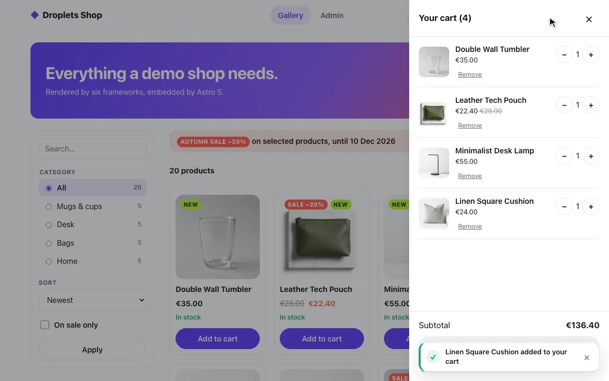
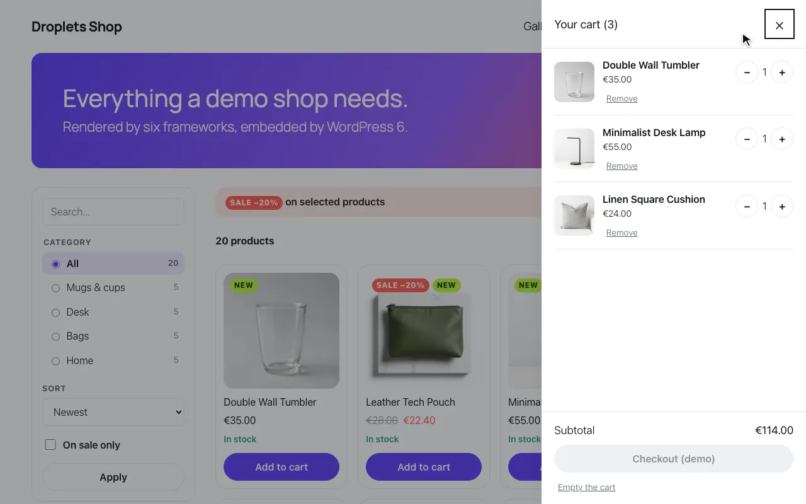
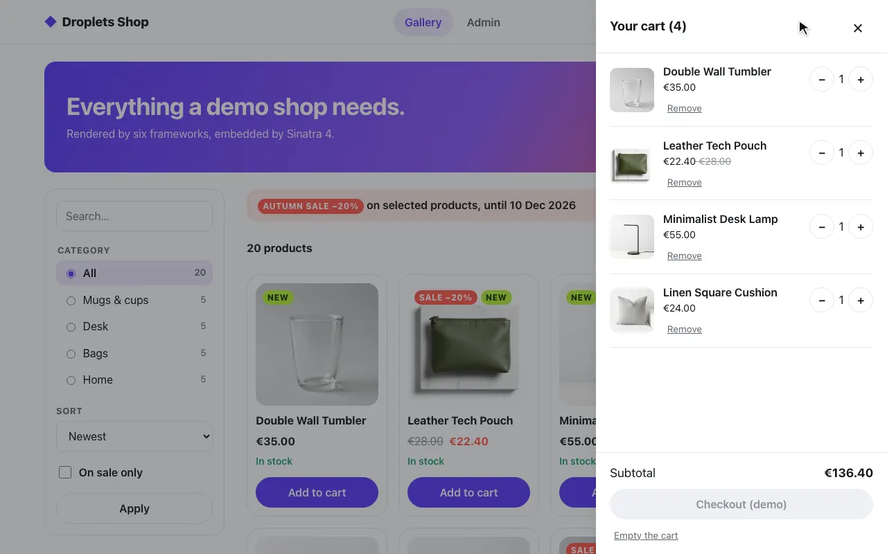
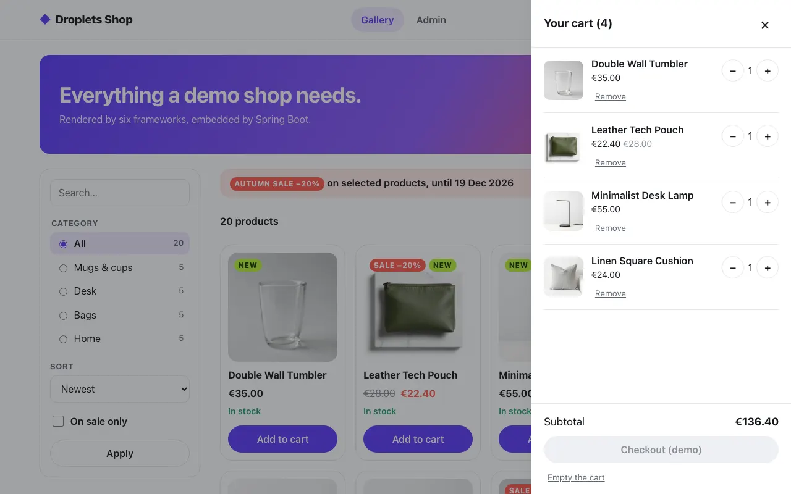
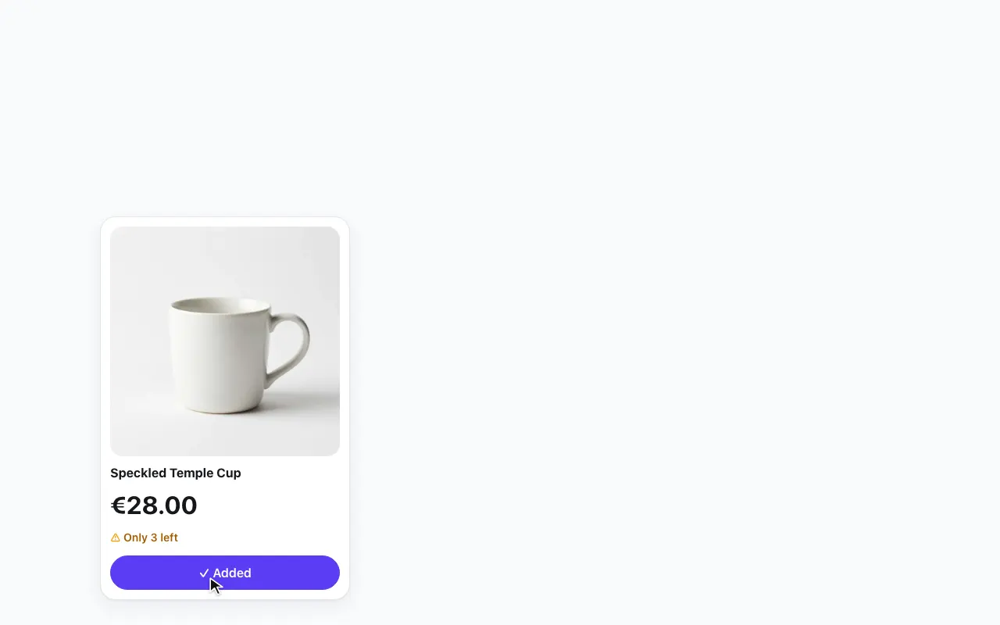

# Embedding droplets from any stack

Droplets is not tied to the framework that renders the page around it. A
droplets server speaks plain HTTP, and everything a host page needs is three
URLs on that server:

| URL | What it is |
| --- | ---------- |
| `GET /droplets/<id>?prop=value` | The droplet as an HTML fragment: a custom element with the server-rendered markup and its data inlined. |
| `GET /index.js` | One small module that defines that element. The element loads each droplet's JavaScript, CSS and data from where the page loaded `/index.js`. |
| `POST /droplets/<id>` | The same fragment, with the props as a JSON body (`{ "props": { … } }`) for props too large or too structured for a URL. |

The element's tag name is the server's `element` setting: `djs-droplet` by
default, `djs-svelte` for the Svelte example these hosts embed.

<!-- hosts:count -->
Seventeen host examples, by language; fifteen run the shared shop flow, and WordPress and htmx have flows of their own.
<!-- /hosts:count -->

Most examples in this folder do the same two things, in their
own language ([Any other stack](https://dropletsjs.dev/integrate/any-stack/)
has the exact headers, for a stack that is not here):

1. **Fetch the fragment on the server** and paste it into the page. The page
   arrives fully rendered; no JavaScript is needed for the first paint.
2. **Load `/index.js` once.** Each droplet element on the page then
   hydrates itself, fetching only its own bundle.

A third pattern, used by single-page apps, skips the server fetch entirely:
render `<djs-svelte data-droplet="client" data-droplet-props='{"who":"Ana"}'>`
yourself and the client takes care of data and rendering.

## Two origins

The host usually reaches the droplets server over an internal address
(`http://droplets:8000` inside Docker) while browsers reach it over a public
one (`http://localhost:8000`). Send the public origin in the
`x-droplet-location` header when fetching a fragment, so the URLs it writes
use that origin, and load `/index.js` from the same place: the browser loads
every droplet from where `/index.js` came from. The droplets server honours
`x-droplet-location` only when its origin is trusted (its own, or in
`DROPLETS_TRUSTED_ORIGINS`), so each compose file
gives it `DROPLETS_TRUSTED_ORIGINS` (the public URL and the host's own
origin). The
[Security model](https://dropletsjs.dev/guides/security/) has what a host
should and should not pass on.

Cross-origin loading needs CORS on the droplets side: set `cors: true` (or an
origin list) in `droplets.config.ts`; for cookies, an origin list with
`credentials: true`, as the shop has for [`static`](./static). The
[nginx example](./nginx) avoids CORS altogether by proxying the droplets
routes under the host's own origin.

## The examples

`hosts.json` in this folder lists every host: its id (the folder, the docs
page's name, `pnpm test:hosts <id>` and the compose project
`droplets-<id>`), its language, its pattern, its port and its docs page. The
docs' sidebar and tables, `tests/hosts/run.mjs` and the generated parts of
this file and the root README are built from it
(`pnpm --filter @dropletsjs/tests-hosts readme`). A host marked `planned` is
reserved there and shown nowhere.

Each folder is standalone, with its own dependencies and a `docker-compose.yml`
that starts it next to the shop and, for most, a droplets server built from the Svelte example,
[`examples/frameworks/svelte`](../frameworks/svelte) (with
[`examples/frameworks/Dockerfile`](../frameworks/Dockerfile)):

```bash
cd examples/hosts/<example>
docker compose up --build
```

<!-- hosts:examples -->
| Language | Folder | Stack | Pattern |
| -------- | ------ | ----- | ------- |
| JavaScript / TypeScript | [`express`](./express) | Node, Express 5 | Fragment fetch in a route handler, or the droplets server mounted inside Express |
| JavaScript / TypeScript | [`nextjs`](./nextjs) | Next.js App Router | Fragment fetch in a server component |
| JavaScript / TypeScript | [`sveltekit`](./sveltekit) | SvelteKit, adapter-node | Fragment fetch in `+page.server.ts`, `{@html}` in the page |
| JavaScript / TypeScript | [`astro`](./astro) | Astro, Node adapter | Fragment fetch in the frontmatter, `set:html` |
| JavaScript / TypeScript | [`react-vite`](./react-vite) | React 19, Vite | A client-side `<Droplet>` component, the shop through a same-origin proxy |
| Python | [`fastapi`](./fastapi) | Python, FastAPI, httpx, Jinja2 | Fragment fetch with `httpx`, pasted into a Jinja2 template |
| Python | [`django`](./django) | Python, Django 6.1, httpx, Django templates | Fragment fetch with `httpx` in a view, pasted into a Django template |
| PHP | [`php`](./php) | PHP 8.3 on Apache, curl, no framework | Fragment fetch with `curl_multi`, pasted into plain PHP templates |
| PHP | [`wordpress`](./wordpress) | WordPress 6, a plugin; WordPress owns the data | A `[droplet]` shortcode plugin serving `examples/wp-shop` |
| Ruby | [`sinatra`](./sinatra) | Ruby, Sinatra, Net::HTTP, ERB | Fragment fetch with `Net::HTTP`, pasted into ERB |
| Ruby | [`rails`](./rails) | Ruby, Rails 8, Net::HTTP, ERB | Fragment fetch with `Net::HTTP` in a controller, pasted into ERB views |
| C# / .NET | [`aspnet`](./aspnet) | C# on .NET 10, ASP.NET Core Razor Pages, `IHttpClientFactory` | Fragment fetch with `HttpClient` in a page model, pasted into a Razor page with `Html.Raw` |
| Java | [`spring`](./spring) | Java 25, Spring Boot 4, RestClient, Thymeleaf | Fragment fetch with `RestClient` in a controller, pasted into a Thymeleaf template |
| Go | [`go`](./go) | Go 1.27, net/http, html/template, no dependencies | Fragment fetch with `net/http`, one goroutine each, pasted into an `html/template` as `template.HTML` |
| No backend code | [`nginx`](./nginx) | nginx, zero application code; an IIS web.config | Server Side Includes and a reverse proxy, same origin |
| No backend code | [`htmx`](./htmx) | htmx 2 on static pages, nginx | `hx-get` swaps the fragments in, proxied or cross-origin; `hx-boost` swaps `<main>` alone |
| No backend code | [`static`](./static) | One HTML page and a script on nginx, no proxy | The page fetches the fragments from the shop's own origin, cross-origin, with the shop's cookies |
<!-- /hosts:examples -->

All of them but `static` render the Svelte example's three droplets on `/`, one per
mode, greeting `?who=`: `client` (rendered in the browser), `ssr-hydrate`
(server-rendered, then hydrated) and `ssr-nohydrate` (server-rendered, no
JavaScript). The other framework examples in
[`examples/frameworks`](../frameworks) have the same three droplets, so the
compose `droplets` service takes any of them with
`args: { EXAMPLE: vue }`.

The interactive ones call the droplets server's `/api` endpoints through
`$droplets/drop`, on the origin the page loaded `/index.js` from. A host that
proxies the droplets server under its own origin (nginx) proxies `/api/*` too.

## The shop demo

Every host also serves the [shop example](../shop) beside the
basic page (WordPress with [wp-shop](../wp-shop) in its place), with one layout: a header with the logo, Gallery and Admin and
the cart badge droplet, and a footer naming the host's stack in large type.
The pages are `/gallery` (hero, `product-filter`, `product-library`),
`/product/<slug>` (breadcrumb, `product-page`, `product-comments`), `/login`
and `/admin`; [`CONTRACT.md`](../shop/CONTRACT.md) says which
props each takes from the page's URL. htmx's pages are static files: its
product page has a link back to the gallery in place of the breadcrumb, and
a product card asked for once revealed under the gallery.

Each host but `static` proxies `/index.js`, `/env.js`, `/index.css`, `/droplets/*`, `/assets/*` and `/api/*` to the
shop under its own origin, so the cart and admin cookies are first-party and
nothing is cross-origin, with a fixed `x-droplet-location` (the host's public
origin, never the request's Host). Hosts that render on the server fetch the
fragments there: they forward the browser's `Cookie`, send the page as
`Referer`, never follow redirects, paste only HTML answers, pass the
fragments' `Set-Cookie` on with the page and their `Link` preloads into its
`<head>`. The SPA (`react-vite`) mounts the droplets in the browser through
the same proxy, and htmx asks for them from the browser through it.
`static` asks the shop on its own origin, cross-origin: the shop answers
its origin with credentials, so its requests carry the cart and admin
cookies ([its README](./static/README.md)).

Two hosts cannot pass a fragment's `Set-Cookie` on: nginx, because an SSI
include is a subrequest whose headers nginx discards, and Next.js, because a
server component may not set cookies. Their READMEs say why and what a page
would need instead. The shop sets cookies only on form actions and `/api`,
which go through the proxy on every host, so its cart and login work there
too.

`docker compose up --build` in each folder starts the shop as well (port
8300, reachable only by the host), with the demo values from
`examples/shop/.env.example` (login: admin / droplets) and the host's origin
in `DROPLETS_TRUSTED_ORIGINS`. The shop's layout CSS is one `shop.css` per
host, the same file everywhere.

<!-- hosts:shop-at -->
| Folder | Opens at |
| ------ | -------- |
| `express` | http://localhost:8003/gallery |
| `nextjs` | http://localhost:8007/gallery |
| `sveltekit` | http://localhost:8006/gallery |
| `astro` | http://localhost:8005/gallery |
| `react-vite` | http://localhost:8004/gallery |
| `fastapi` | http://localhost:8001/gallery |
| `django` | http://localhost:8012/gallery |
| `php` | http://localhost:8009/gallery |
| `wordpress` | http://localhost:8008/gallery |
| `sinatra` | http://localhost:8002/gallery |
| `rails` | http://localhost:8015/gallery |
| `aspnet` | http://localhost:8014/gallery |
| `spring` | http://localhost:8016/gallery |
| `go` | http://localhost:8017/gallery |
| `nginx` | http://localhost:8081/gallery |
| `htmx` | http://localhost:8010/ |
| `static` | http://localhost:8011/gallery |
<!-- /hosts:shop-at -->

nginx's shop is on a second `server` block (8081): its basic server owns
`/index.js` on 8080. htmx opens on the Svelte example's droplets (`/`), its
shop on `/gallery`. WordPress answers once `wordpress-init` has installed it
and activated the plugin, about a minute.

### Type-checked

Each Node host (`astro`, `express`, `nextjs`, `react-vite`, `sveltekit`)
declares its own types and checks them with `npm run typecheck`. From the
repository root, `pnpm typecheck:hosts [host…]` runs `npm ci` and that
script in each.

### End to end, recorded

[`tests/hosts`](../../tests/hosts) runs one flow in a browser against each
host's compose stack: the gallery, a product into the cart (the badge
counts it), the admin login and that product's stock set to 0, the gallery
again, and the product page saying "Out of stock". Docker and Playwright's
Chromium are all it needs; the stacks run one at a time and are taken down
after. Its `test/` folder holds static checks that need neither and run in
`pnpm check`: the `shop.css` copies the same, every host's
`x-droplet-location` from its environment, every example standing on its
own, htmx's shop pages sharing their head, header and footer.

```bash
pnpm test:hosts                     # every host but wordpress and htmx (those only by name)
pnpm test:hosts express sveltekit   # some
pnpm test:hosts wordpress           # the WordPress showcase
pnpm test:hosts htmx                # the htmx shop and Svelte page, their own flow (e2e/htmx.spec.ts)
pnpm test:hosts express --https     # express behind Caddy on https://127-0-0-1.sslip.io:8443
pnpm test:hosts --docs              # also refresh the screenshots below
HOSTS_PORT_BASE=18000 pnpm test:hosts  # other ports (below)
```

Each run records an MP4 with a drawn cursor (`tests/hosts/recordings/<host>.mp4`,
converted from Playwright's WebM with ffmpeg) and its screenshots
(`recordings/<host>/`), all gitignored. `--docs` writes small copies into the
docs site (`apps/docs/public/hosts/`: a 720p MP4 and four WebP screenshots per
host), which each host's page in the docs shows with how that host is set
up, and the [shop demo](https://dropletsjs.dev/integrate/hosts/shop-demo/)
page ([source](../../apps/docs/src/content/docs/integrate/hosts/shop-demo.mdx)) all together,
with a diagram of how the pieces talk. A second test turns JavaScript off and
adds a product from its page: the post answers `303` back to the host page
(Post/Redirect/Get) and the result shows there; it is skipped for the SPA.
The `--https` run checks that the `cart_id` and `shop_admin` cookies arrive
`Secure` off localhost (see [express](./express/README.md#over-https-off-localhost)).

<!-- hosts:recordings -->
| Host | Video | A screenshot from its flow |
| ---- | ----- | -------------------------- |
| `express` | [express.mp4](../../apps/docs/public/hosts/express.mp4) |  |
| `nextjs` | [nextjs.mp4](../../apps/docs/public/hosts/nextjs.mp4) |  |
| `sveltekit` | [sveltekit.mp4](../../apps/docs/public/hosts/sveltekit.mp4) |  |
| `astro` | [astro.mp4](../../apps/docs/public/hosts/astro.mp4) |  |
| `react-vite` | [react-vite.mp4](../../apps/docs/public/hosts/react-vite.mp4) |  |
| `fastapi` | [fastapi.mp4](../../apps/docs/public/hosts/fastapi.mp4) |  |
| `django` | [django.mp4](../../apps/docs/public/hosts/django.mp4) |  |
| `php` | [php.mp4](../../apps/docs/public/hosts/php.mp4) |  |
| `wordpress` | [wordpress.mp4](../../apps/docs/public/hosts/wordpress.mp4) |  |
| `sinatra` | [sinatra.mp4](../../apps/docs/public/hosts/sinatra.mp4) |  |
| `rails` | [rails.mp4](../../apps/docs/public/hosts/rails.mp4) |  |
| `aspnet` | [aspnet.mp4](../../apps/docs/public/hosts/aspnet.mp4) |  |
| `spring` | [spring.mp4](../../apps/docs/public/hosts/spring.mp4) |  |
| `go` | [go.mp4](../../apps/docs/public/hosts/go.mp4) |  |
| `nginx` | [nginx.mp4](../../apps/docs/public/hosts/nginx.mp4) |  |
| `htmx` | [htmx.mp4](../../apps/docs/public/hosts/htmx.mp4) |  |
| `static` | [static.mp4](../../apps/docs/public/hosts/static.mp4) |  |
<!-- /hosts:recordings -->

### Ports

Each `docker-compose.yml` publishes its ports on 127.0.0.1 only, and takes
them and its public URLs from the environment, with the values above as
defaults: `WEB_PORT` and `WEB_URL` for the host, `DROPLETS_PORT` and
`DROPLETS_URL` for the droplets server. `HOSTS_PORT_BASE` has
`pnpm test:hosts` set them from one block of a hundred ports: the droplets
server on the base, each host on the base plus its offset in `hosts.json`
(`HOSTS_PORT_BASE=18000`: express on 18003, nginx on 18081). Each stack
runs as the compose project `droplets-<host>`, on whatever Docker the
environment points at.
